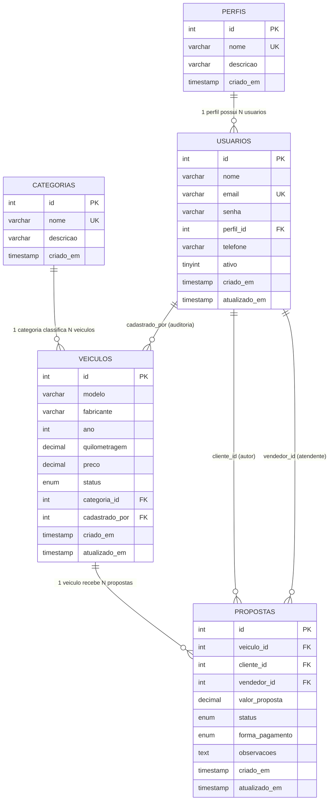

# 🚗 AutoPrime Motors - Sistema Integrado de Gestão de Concessionária

> **Projeto Integrador de Desenvolvimento Web & Banco de Dados**  
> **Entrega Final:** Sistema Completo em Funcionamento, Autenticação JWT, RBAC, CRUD Integrado e Banco Relacional MySQL Workbench  
> **Repositório Oficial no GitHub:** [github.com/Otaviiiiozzz/repositorio-concessionaria](https://github.com/Otaviiiiozzz/repositorio-concessionaria)  
> **Autor:** Otávio Martins | **Instituição:** Senac RS  

---

## 📌 1. Apresentação do Problema & Proposta de Solução

### 🔴 O Problema Identificado
Concessionárias de veículos multimarcas enfrentam desafios críticos na gestão de suas operações diárias:
1. **Descontrole de Estoque:** Informações descentralizadas geram divergências entre o estoque físico e os veículos ofertados, ocasionando vendas duplicadas ou negociações de veículos já reservados.
2. **Perda de Oportunidades Comerciais:** Propostas de compra, contrapropostas e preferências de pagamento de clientes são frequentemente anotadas em papéis ou mensagens informais, impossibilitando métricas de conversão e rastreabilidade.
3. **Ausência de Rastreamento de Vendas:** Dificuldade em identificar qual vendedor cadastrou cada automóvel ou intermediou cada proposta comercial.
4. **Vulnerabilidades de Segurança:** Sistemas legados que não diferenciam permissões de funcionários, permitindo que operadores comuns excluam dados estratégicos, além do armazenamento inseguro de credenciais em texto puro.

### 🟢 A Solução: AutoPrime Motors
O **AutoPrime Motors** é uma aplicação web full-stack desenvolvida para modernizar e blindar a gestão de concessionárias de automóveis:
- **Estoque & Catálogo Inteligente (CRUD Completo):** Cadastro, consulta com múltiplos filtros combinados (busca textual, categoria, fabricante, faixa de preço, ordenação e status), edição cadastral e exclusão de veículos no banco **MySQL**.
- **Regra de Negócio de Reserva Automática:** Ao aprovar uma proposta comercial de um cliente, o veículo vinculado passa automaticamente do status `'disponivel'` para `'reservado'` no estoque da concessionária.
- **Fluxo Relacional de Propostas de Compra:** Clientes autenticados realizam propostas de compra com valor ofertado, observações e forma de pagamento (`À Vista`, `Financiamento`, `Consórcio` ou `Veículo na Troca`). Vendedores e administradores analisam e deliberam sobre as propostas.
- **Controle de Acesso Baseado em Perfis (RBAC):** Autenticação com **JSON Web Tokens (JWT)** e senhas criptografadas com **bcrypt** (fator de custo 10). As permissões são validadas de forma estrita no back-end via middlewares da API (não apenas escondendo botões na tela).
- **Métricas Consolidadas:** Dashboard com indicadores em tempo real: total de veículos, veículos disponíveis, valor total do patrimônio em estoque e quilometragem média.
- **Gestão Centralizada de Usuários:** Painel exclusivo para o Administrador visualizar todas as contas cadastradas e ativar/inativar o acesso de usuários com um clique.

---

## 🛠️ 2. Tecnologias Utilizadas

| Camada | Tecnologias | Descrição / Finalidade |
| :--- | :--- | :--- |
| **Front-end** | HTML5 Semântico, CSS3 Moderno, JavaScript (ES6+) | Interface limpa, responsiva, Dark Theme automotivo premium, manipulação dinâmica do DOM e consumo de API REST via **Fetch API** (`async/await`). |
| **Back-end** | Node.js, Express.js (v5) | Arquitetura RESTful modularizada em Camadas (Rotas, Controllers, Middlewares e Database). |
| **Segurança** | `bcryptjs`, `jsonwebtoken` (JWT), `dotenv`, `cors` | Criptografia de senhas (salt rounds = 10), tokens assinados digitalmente e middlewares de autenticação/autorização (RBAC). |
| **Banco de Dados** | MySQL 8.0 / MariaDB, MySQL Workbench | Banco relacional estruturado com 5 tabelas, chaves primárias, chaves estrangeiras com ações referenciais (`CASCADE`, `SET NULL`, `RESTRICT`) e índices de busca. |
| **Resiliência** | Adaptador Local Resiliente (`dados_locais.json`) | Fallback automático que garante funcionamento contínuo mesmo caso o serviço MySQL não esteja ativo localmente. |
| **Testes & Qualidade** | Suíte Automatizada E2E (`tests/test-api.js`), Thunder Client | 33 testes automatizados cobrindo 100% dos fluxos de banco, CRUD, autenticação, permissões e regras de negócio. |

---

## 📁 3. Estrutura Completa do Repositório

```text
repositorio-concessionaria/
├── .vscode/                               # Configurações do VS Code
│   ├── extensions.json                    # Recomendações de extensões (Thunder Client, etc.)
│   ├── launch.json                        # Depuração do Node.js (F5)
│   ├── settings.json                      # Configurações do editor
│   └── tasks.json                         # Tarefas integradas (Iniciar e Testar)
├── backend/                               # Servidor RESTful Node.js + Express
│   ├── controllers/                       # Lógica de negócio da aplicação
│   │   ├── authController.js              # Registro público, login e dados do usuário logado
│   │   ├── propostasController.js         # Envio, listagem e aprovação de propostas comerciais
│   │   ├── usuariosController.js          # Gestão de usuários e ativação de contas (Admin)
│   │   └── veiculosController.js          # CRUD de veículos, filtros e resumo do estoque
│   ├── database/                          # Camada de persistência e banco de dados
│   │   ├── conexao.js                     # Pool de conexão MySQL e fallback resiliente local
│   │   ├── dados_locais.json              # Armazenamento resiliente local
│   │   ├── migrar.js                      # Utilitário de migração de colunas e constraints
│   │   ├── resetar.js                     # Restauração dos dados iniciais padrão
│   │   └── testar-conexao.js              # Diagnóstico de conectividade com MySQL Workbench
│   ├── middlewares/                       # Interceptadores de requisições
│   │   ├── authMiddleware.js              # Validação de token JWT e controle RBAC por perfil
│   │   └── corsMiddleware.js              # Configuração de CORS para requisições cross-origin
│   ├── routes/                            # Definição e roteamento dos endpoints da API
│   │   ├── authRoutes.js                  # /auth (registrar, login, me, perfis)
│   │   ├── propostasRoutes.js             # /propostas (criar, minhas, todas, status)
│   │   ├── usuariosRoutes.js              # /usuarios (listar, criar, obter por id, status)
│   │   └── veiculosRoutes.js              # /veiculos (CRUD completo, resumo, categorias)
│   ├── .env.example                       # Exemplo de configuração de variáveis de ambiente
│   ├── package.json                       # Metadados e dependências do back-end
│   └── server.js                          # Ponto de entrada do servidor Express
├── frontend/                              # Interface com o Usuário (SPA Vanilla)
│   ├── index.html                         # Estrutura semântica e modais interativos
│   ├── script.js                          # Integração Fetch API, manipulação do DOM e RBAC
│   └── style.css                          # Folha de estilos Dark Theme Premium
├── sql/                                   # Scripts de Banco de Dados Relacional
│   └── concessionaria.sql                 # Script DDL/DML oficial para o MySQL Workbench
├── tests/                                 # Suíte de Testes Automatizados E2E
│   └── test-api.js                        # 33 testes automatizados (100% de aprovação)
├── thunder-client/                        # Coleções Thunder Client para importação manual
│   ├── thunder-collection_autoprime.json  # 18 requisições prontas da API
│   └── thunder-environment_autoprime.json # Variáveis com tokens JWT de Admin, Vendedor e Cliente
├── thunder-tests/                         # Sincronização nativa direta do Thunder Client no VS Code
│   ├── thunder-collection_autoprime.json
│   └── thunder-environment_autoprime.json
├── thunder_client_codigos/                # Guia detalhado de uso do Thunder Client
│   └── rotas_thunder_client.md
├── .gitignore                             # Ignora node_modules, .env e arquivos temporários
├── GUIA_APRESENTACAO_ESCOLA.md            # Roteiro passo a passo para apresentação escolar
├── README.md                              # Documentação oficial do projeto
├── iniciar-mysql.bat                      # Inicializador do motor MySQL local
├── iniciar-servidor.bat                   # Inicializador do servidor Node.js
├── resetar-dados.bat                      # Script para restaurar dados padrão da concessionária
├── subir-github.bat                       # Script para sincronização com o repositório GitHub
├── testar-api.bat                         # Executa os 33 testes automatizados
└── verificar-mysql.bat                    # Testa a conexão com o MySQL Workbench
```

---

## 🗄️ 4. Modelagem do Banco de Dados Relacional (MySQL)

O banco de dados `concessionaria` foi projetado seguindo as normas da modelagem relacional, garantindo integridade referencial, normalização e controle de concorrência.

### Diagrama Entidade-Relacionamento (ER)



### Detalhamento das 5 Tabelas e Relacionamentos

1. **`perfis`**: Níveis de acesso do sistema (`admin`, `vendedor`, `cliente`).
2. **`usuarios`**: Contas cadastradas. Senhas protegidas com hash `bcrypt`. Chave estrangeira `perfil_id` com `ON DELETE RESTRICT` e `ON UPDATE CASCADE`.
3. **`categorias`**: Classificação de veículos (`Sedan`, `SUV`, `Hatch`, `Picape`, `Esportivo`).
4. **`veiculos`**: Entidade principal de estoque. Chaves estrangeiras `categoria_id` (N:1 com `categorias`) e `cadastrado_por` (N:1 com `usuarios`), ambas com `ON DELETE SET NULL`. Enum de status: `'disponivel'`, `'reservado'`, `'vendido'`.
5. **`propostas`**: Negociações comerciais. Chaves estrangeiras `veiculo_id` (`ON DELETE CASCADE`), `cliente_id` (`ON DELETE CASCADE`) e `vendedor_id` (`ON DELETE SET NULL`). Formas de pagamento permitidas: `'a_vista'`, `'financiamento'`, `'consorcio'`, `'troca'`.

### Script SQL Disponível
O script DDL/DML completo com criação do banco, constraints, índices e dados iniciais está disponível em:  
👉 **[`sql/concessionaria.sql`](file:///sql/concessionaria.sql)**

---

## 👥 5. Perfis de Usuário & Controle de Permissões (RBAC)

O sistema conta com 3 perfis distintos. As permissões são aplicadas de forma rigorosa na API via middlewares:

| Perfil | Catálogo de Veículos | Cadastro / Edição de Veículos | Exclusão de Veículos | Envio de Propostas | Aprovação de Propostas | Gestão de Usuários |
| :--- | :---: | :---: | :---: | :---: | :---: | :---: |
| **Visitante** (Sem Login) | ✅ Visualização pública | ❌ 401 Unauthorized | ❌ 401 Unauthorized | ❌ Requer Login | ❌ 401 Unauthorized | ❌ 401 Unauthorized |
| **Cliente** (`cliente`) | ✅ Visualização pública | ❌ 403 Forbidden | ❌ 403 Forbidden | ✅ **Permitido** (`POST /propostas`) | ❌ 403 Forbidden | ❌ 403 Forbidden |
| **Vendedor** (`vendedor`) | ✅ Visualização pública | ✅ **Permitido** (`POST`/`PUT`) | ❌ 403 Forbidden | ✅ Permitido | ✅ **Aprova / Recusa** (`PATCH`) | ❌ 403 Forbidden |
| **Administrador** (`admin`) | ✅ Visualização pública | ✅ **Permitido** (`POST`/`PUT`) | ✅ **Exclusividade do Admin** (`DELETE`) | ✅ Permitido | ✅ **Gestão Total** | ✅ **Exclusividade do Admin** |

### Credenciais Padrão Pré-Cadastradas no Banco
| Perfil | E-mail | Senha | Função na Demonstração |
| :--- | :--- | :--- | :--- |
| 🔴 **Administrador** | `admin@autoprime.com` | `admin123` | Excluir veículos do estoque, gerenciar usuários e ativar/inativar contas. |
| 🟡 **Vendedor** | `vendedor@autoprime.com` | `vendedor123` | Cadastrar e editar veículos; aprovar ou recusar propostas de compra. |
| 🔵 **Cliente** | `cliente@autoprime.com` | `cliente123` | Visualizar catálogo e enviar propostas comerciais de compra. |

> ⚡ **Acesso Rápido na Interface:** O modal de Login possui botões de 1 clique (**Admin**, **Vendedor**, **Cliente**) para agilizar testes e apresentações ao vivo.

---

## 📡 6. Documentação das Rotas da API RESTful

A API responde em `http://localhost:3000` em formato JSON padronizado.

### Módulo: Autenticação (`/auth`)
| Método | Rota | Acesso | Descrição | Status Sucesso |
| :--- | :--- | :--- | :--- | :---: |
| `POST` | `/auth/registrar` | Público | Cadastra um novo cliente com senha criptografada via bcrypt | `201 Created` |
| `POST` | `/auth/login` | Público | Autentica e-mail/senha e retorna Token JWT | `200 OK` |
| `GET` | `/auth/me` | Bearer Token | Retorna perfil e dados do usuário logado | `200 OK` |
| `GET` | `/auth/perfis` | Público | Lista perfis de acesso cadastrados | `200 OK` |

### Módulo: Veículos (`/veiculos`) - Entidade Principal (CRUD)
| Método | Rota | Acesso | Descrição / Parâmetros | Status Sucesso |
| :--- | :--- | :--- | :--- | :---: |
| `GET` | `/veiculos` | Público | Lista veículos com suporte a filtros: `?busca=`, `?fabricante=`, `?categoria_id=`, `?status=`, `?preco_max=`, `?ordenar=` | `200 OK` |
| `GET` | `/veiculos/:id` | Público | Detalhes de um veículo por ID com categoria e criador | `200 OK` |
| `GET` | `/veiculos/resumo` | Público | Estatísticas consolidadas (total, disponíveis, valor total, km média) | `200 OK` |
| `GET` | `/categorias` | Público | Lista todas as categorias de veículos cadastradas | `200 OK` |
| `POST` | `/veiculos` | Admin / Vendedor | Cadastra novo veículo no estoque da concessionária | `201 Created` |
| `PUT` | `/veiculos/:id` | Admin / Vendedor | Atualiza dados cadastrais e status do veículo | `200 OK` |
| `DELETE`| `/veiculos/:id` | **Exclusivo Admin** | Remove permanentemente o veículo do estoque | `200 OK` |

### Módulo: Propostas de Negociação (`/propostas`)
| Método | Rota | Acesso | Descrição | Status Sucesso |
| :--- | :--- | :--- | :--- | :---: |
| `POST` | `/propostas` | Autenticado | Envia proposta comercial para um veículo | `201 Created` |
| `GET` | `/propostas/minhas` | Cliente | Lista histórico de propostas enviadas pelo cliente logado | `200 OK` |
| `GET` | `/propostas` | Admin / Vendedor | Lista todas as propostas da concessionária com dados do veículo e cliente | `200 OK` |
| `PATCH`| `/propostas/:id/status` | Admin / Vendedor | Atualiza status da proposta (`aprovada` / `recusada`). **Ao aprovar, o veículo é automaticamente reservado no estoque!** | `200 OK` |

### Módulo: Gestão de Usuários (`/usuarios`)
| Método | Rota | Acesso | Descrição | Status Sucesso |
| :--- | :--- | :--- | :--- | :---: |
| `GET` | `/usuarios` | **Exclusivo Admin** | Lista todos os usuários cadastrados e seus perfis | `200 OK` |
| `POST` | `/usuarios` | **Exclusivo Admin** | Cadastra usuário com definição de perfil (Admin, Vendedor, Cliente) | `201 Created` |
| `GET` | `/usuarios/:id` | Admin ou Próprio | Consulta dados cadastrais de um usuário específico | `200 OK` |
| `PATCH`| `/usuarios/:id/status`| **Exclusivo Admin** | Ativa ou desativa a conta de um usuário | `200 OK` |

---

## ⚡ 7. Instalação e Execução

### Pré-Requisitos
- **Node.js** (versão 18.x, 20.x ou superior).
- **MySQL Server** (8.0+) ou **MariaDB** com **MySQL Workbench** instalado.
- **Git** instalado.

### Passo 1: Clonar o Repositório
```bash
git clone https://github.com/Otaviiiiozzz/repositorio-concessionaria.git
cd repositorio-concessionaria
```

### Passo 2: Instalar as Dependências do Back-end
```bash
cd backend
npm install
cd ..
```

### Passo 3: Configurar o Banco de Dados MySQL
1. Abra o **MySQL Workbench**.
2. Abra o arquivo [`sql/concessionaria.sql`](file:///sql/concessionaria.sql) e execute todo o script (ícone de raio ⚡).
3. Opcionalmente, verifique o arquivo `backend/.env` (já configurado por padrão com `root:admin` na porta `3306`).

### Passo 4: Inicializar o Sistema
Você pode inicializar de forma rápida usando os atalhos ou manualmente:

#### 🚀 Forma Rápida (Atalhos .bat):
1. Dê duplo-clique em **`iniciar-mysql.bat`** (inicia o serviço do banco).
2. Dê duplo-clique em **`iniciar-servidor.bat`** (inicia a API em http://localhost:3000).
3. Abra **`frontend/index.html`** no navegador.

#### 💻 Forma Manual (Terminal):
```bash
# Terminal 1 - Iniciar a API:
cd backend
npm start

# Em seguida, abra frontend/index.html no navegador ou use a extensão Live Server do VS Code.
```

---

## 🧪 8. Testes Automatizados E2E (33/33 Casos Aprovados)

O projeto conta com uma suíte completa de testes de ponta a ponta validando **100% dos requisitos da rubrica avaliativa**.

### Como Rodar os Testes:
```bash
# Com o servidor rodando em http://localhost:3000:
node tests/test-api.js
# Ou dê duplo-clique no script testar-api.bat
```

### Relatório de Execução dos Testes:
```text
=======================================================
🚗 AutoPrime - Suíte de Testes da API (CRUD, Auth & MySQL)
🎯 Alvo: http://localhost:3000
=======================================================

🔹 1. Rota raiz e documentação pública...
  ✔ [PASSOU] GET / responde com status 200
  ✔ [PASSOU] GET / lista rotas da API

🔹 2. Catálogo público de veículos...
  ✔ [PASSOU] GET /veiculos é público (200)
  ✔ [PASSOU] GET /veiculos retorna lista de automóveis
  ✔ [PASSOU] GET /veiculos/resumo retorna métricas consolidadas
  ✔ [PASSOU] GET /veiculos?status=disponivel filtra veículos disponíveis (200)

🔹 3. Cadastro de Usuários (POST /auth/registrar)...
  ✔ [PASSOU] POST /auth/registrar cadastra usuário com sucesso (201)
  ✔ [PASSOU] POST /auth/registrar retorna token JWT e dados sem expor senha
  ✔ [PASSOU] POST /auth/registrar rejeita e-mail duplicado com status 409
  ✔ [PASSOU] POST /auth/registrar rejeita senha com menos de 6 caracteres (400)

🔹 4. Autenticação e Login com bcrypt e JWT...
  ✔ [PASSOU] Login de Administrador aprovado com sucesso (200)
  ✔ [PASSOU] Login retorna token JWT válido assinado
  ✔ [PASSOU] Login de Vendedor aprovado com perfil 'vendedor' (200)
  ✔ [PASSOU] Login de Cliente aprovado com perfil 'cliente' (200)
  ✔ [PASSOU] Login com senha incorreta rejeitado com 401 Unauthorized

🔹 5. Validação de Middleware de Autenticação...
  ✔ [PASSOU] GET /auth/me sem token rejeita com status 401
  ✔ [PASSOU] GET /auth/me com token inválido rejeita com status 403
  ✔ [PASSOU] GET /auth/me com token válido retorna dados do usuário logado (200)

🔹 6. Controle de Acesso por Perfil (RBAC)...
  ✔ [PASSOU] Cliente é BLOQUEADO ao tentar cadastrar veículo (403 Forbidden)
  ✔ [PASSOU] Vendedor CADASTRA veículo com sucesso (201 Created)
  ✔ [PASSOU] Vendedor EDITA dados do veículo com sucesso (200 OK)
  ✔ [PASSOU] Vendedor é BLOQUEADO ao tentar excluir veículo (403 Forbidden)
  ✔ [PASSOU] Administrador EXCLUI veículo com sucesso (200 OK)
  ✔ [PASSOU] Veículo excluído não existe mais no estoque (404 Not Found)

🔹 7. Gerenciamento de Usuários (RBAC Admin)...
  ✔ [PASSOU] Cliente é impedido de listar outros usuários (403 Forbidden)
  ✔ [PASSOU] Administrador lista todos os usuários cadastrados (200 OK)
  ✔ [PASSOU] Administrador inativa conta de usuário (200 OK)
  ✔ [PASSOU] Administrador reativa conta de usuário com sucesso (200 OK)

🔹 8. Negociação & Propostas (Tabelas Relacionadas)...
  ✔ [PASSOU] Cliente envia proposta de compra associada a um veículo (201 Created)
  ✔ [PASSOU] Cliente consulta apenas o seu histórico de propostas (200 OK)
  ✔ [PASSOU] Vendedor acessa lista geral de propostas da concessionária (200 OK)
  ✔ [PASSOU] Vendedor atualiza status da proposta para 'aprovada' (200 OK)
  ✔ [PASSOU] Regra de negócio: Veículo passa para status 'reservado' ao aprovar proposta

=======================================================
📊 Relatório da Execução de Testes:
   Total de Casos Testados: 33
   Aprovados com Sucesso:   33
   Falhas Encontradas:      0
=======================================================

🎉 100% DOS TESTES FORAM APROVADOS COM SUCESSO!
```

---

## ⚡ 9. Testes com Thunder Client no VS Code

As pastas `thunder-client/` e `thunder-tests/` contêm todas as requisições configuradas com parâmetros e tokens automáticos para demonstração:
1. Abra a extensão **Thunder Client** no VS Code.
2. Na aba **Collections**, selecione **AutoPrime - Concessionária & Autenticação**.
3. Selecione o Environment **AutoPrime Local**.
4. Execute os testes manuais nas pastas `/auth`, `/veiculos`, `/propostas` e `/usuarios`.
5. Consulte o guia passo a passo em: [`thunder_client_codigos/rotas_thunder_client.md`](file:///thunder_client_codigos/rotas_thunder_client.md).

---

## 📋 10. Checklist de Atendimento aos Requisitos da Rubrica

| Requisito Avaliado | Situação | Evidência no Repositório |
| :--- | :---: | :--- |
| **Cadastro, login e autenticação** | ✅ Concluído | `authController.js` com bcrypt (`saltRounds=10`) e JWT assinado com perfil. |
| **Níveis de acesso e controle de permissões** | ✅ Concluído | `authMiddleware.js` (`autenticarToken` e `autorizarPerfis`) bloqueia na API (401/403) e na UI. |
| **Banco de dados e relacionamentos** | ✅ Concluído | 5 tabelas no MySQL com PK, FK (`CASCADE`, `RESTRICT`, `SET NULL`), índices e script `sql/concessionaria.sql`. |
| **CRUD e regras de negócio** | ✅ Concluído | CRUD completo em `veiculos`, validação de ano/km/preço, e reserva automática ao aprovar propostas. |
| **Interface e integração completa** | ✅ Concluído | Interface reativa em `index.html` e `script.js` consumindo API via Fetch, modais, filtros e métricas. |
| **Tratamento básico de erros** | ✅ Concluído | Respostas HTTP estruturadas (`400`, `401`, `403`, `404`, `409`, `500`) e mensagens amigáveis na UI. |
| **Funcionalidades específicas da proposta** | ✅ Concluído | Gestão de propostas, formas de pagamento, reserva de veículos e gestão de contas pelo Administrador. |
| **README.md final completo** | ✅ Concluído | Documentação completa com DER, tecnologias, estrutura, instalação, rotas e testes. |

---

## 👨‍💻 Autor & Licença
- **Estudante:** Otávio Martins
- **Instituição:** Senac RS
- **Licença:** MIT
