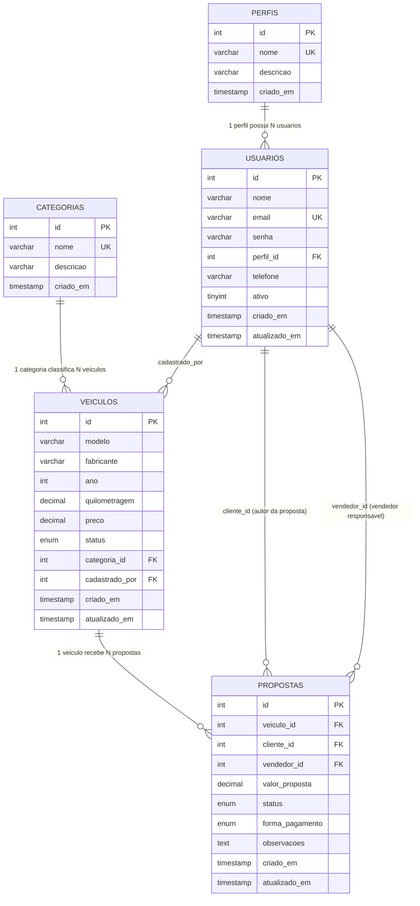

# 🚗 AutoPrime Motors - Sistema de Gestão de Concessionária

> **Projeto Integrador de Desenvolvimento Web & Banco de Dados**  
> **Entrega Atual:** Banco de Dados Relacional & Autenticação (JWT e RBAC)  
> **Repositório Oficial:** [github.com/Otaviiiiozzz/repositorio-concessionaria](https://github.com/Otaviiiiozzz/repositorio-concessionaria)

---

## 📌 1. Apresentação do Problema & Proposta de Solução

O **AutoPrime Motors** é um sistema completo desenvolvido para solucionar os desafios reais da gestão de uma concessionária de automóveis:
- **Centralização de Estoque:** Cadastro, atualização e catálogo dinâmico de veículos por categoria, fabricante, quilometragem e valor de venda.
- **Relacionamento Comercial:** Gestão de propostas de compra enviadas por clientes e analisadas pela equipe de vendas.
- **Segurança da Informação:** Controle estrito de acessos com autenticação via **JSON Web Token (JWT)**, criptografia irreversível de senhas com **bcrypt** e segregação de permissões por perfil (**RBAC**).
- **Persistência Relacional:** Modelagem de dados com múltiplas tabelas normalizadas no **MySQL**, com chaves primárias, estrangeiras e integridade referencial.
- **Alta Resiliência:** Suporte nativo ao **MySQL Workbench** com sistema de **fallback automático local (JSON)** que permite a execução imediata em qualquer ambiente de apresentação no VSCode.

---

## 🗄️ 2. Modelagem do Banco de Dados Relacional (MySQL)

O sistema implementa **5 tabelas relacionadas** com chaves primárias (`PRIMARY KEY`), chaves estrangeiras (`FOREIGN KEY`), índices e integridade referencial com ações `ON DELETE RESTRICT`, `CASCADE` e `SET NULL`.

### Diagrama Entidade-Relacionamento (DER)



### Script SQL Disponível no Repositório
O script DDL e DML completo com a criação de tabelas, chaves e dados padrão (seed) está localizado em:
👉 **[`sql/concessionaria.sql`](file:///sql/concessionaria.sql)**

---

## 🔐 3. Cadastro, Autenticação e Segurança de Senhas

### Proteção de Senhas com Bcrypt
- Nenhuma senha é armazenada em texto puro.
- O cadastro e alteração de senhas utilizam **`bcryptjs`** com fator de custo (**salt rounds = 10**), gerando hashes criptográficos unidirecionais.
- Na autenticação (`POST /auth/login`), a validação é feita via comparação segura (`bcrypt.compare`), prevenindo ataques de timing e garantindo a privacidade das credenciais.

### Autenticação Stateless com JWT
- O login gera um **JSON Web Token (JWT)** assinado com algoritmo HMAC SHA-256 e chave secreta (`JWT_SECRET`).
- O payload do token carrega a identidade e a função do usuário (`id`, `nome`, `email`, `perfil`), com prazo de expiração configurável (`JWT_EXPIRES_IN=8h`).
- O middleware de autenticação intercepta requisições protegidas via cabeçalho HTTP:
  ```http
  Authorization: Bearer <TOKEN_JWT>
  ```
- Retorna **`401 Unauthorized`** quando o token não é fornecido e **`403 Forbidden`** quando o token é inválido ou expirado.

---

## 👥 4. Perfis de Usuário & Controle de Acesso (RBAC)

O sistema define 3 níveis de acesso diferenciados:

| Perfil | Nome no Sistema | Permissões & Regras de Negócio |
| :--- | :--- | :--- |
| **Administrador** | `admin` | Acesso total irrestrito: gerencia usuários, ativa/desativa contas, visualiza propostas, cadastra e **exclui veículos** do estoque. |
| **Vendedor** | `vendedor` | Gestão comercial: cadastra e atualiza veículos no estoque, consulta e aprova/recusa propostas de compra. |
| **Cliente** | `cliente` | Consulta o catálogo público, visualiza detalhes e envia **propostas de negociação** para veículos. |

### Contas de Demonstração Pré-Configuradas

| Perfil | E-mail de Login | Senha Padrão |
| :--- | :--- | :--- |
| 🔴 **Administrador** | `admin@autoprime.com` | `admin123` |
| 🟡 **Vendedor** | `vendedor@autoprime.com` | `vendedor123` |
| 🔵 **Cliente** | `cliente@autoprime.com` | `cliente123` |

---

## 🛣️ 5. Matriz de Rotas da API

### Módulo: Autenticação (`/auth`)
- `POST /auth/registrar` — Cadastro de usuário (**Público**)
- `POST /auth/login` — Autenticação com validação de hash e geração de JWT (**Público**)
- `GET  /auth/me` — Perfil do usuário autenticado (**Requer JWT**)
- `GET  /auth/perfis` — Lista perfis do sistema (**Público**)

### Módulo: Gestão de Usuários (`/usuarios`)
- `GET   /usuarios` — Lista usuários (**Requer Admin**)
- `POST  /usuarios` — Cria usuário com perfil específico (**Requer Admin**)
- `GET   /usuarios/:id` — Dados de um usuário (**Admin ou Próprio Usuário**)
- `PATCH /usuarios/:id/status` — Ativa ou inativa conta (**Requer Admin**)

### Módulo: Veículos (`/veiculos`)
- `GET    /veiculos` — Listagem do catálogo com filtros (**Público**)
- `GET    /veiculos/resumo` — Resumo estatístico do estoque (**Público**)
- `GET    /veiculos/:id` — Detalhes de um veículo específico (**Público**)
- `POST   /veiculos` — Cadastra veículo no estoque (**Requer Vendedor ou Admin**)
- `PUT    /veiculos/:id` — Atualiza dados cadastrais (**Requer Vendedor ou Admin**)
- `DELETE /veiculos/:id` — Remove veículo do catálogo (**Requer Admin**)

### Módulo: Propostas de Compra (`/propostas`)
- `POST  /propostas` — Envia proposta de compra para veículo (**Requer Cliente/Autenticado**)
- `GET   /propostas/minhas` — Lista propostas do próprio cliente (**Requer Cliente**)
- `GET   /propostas` — Lista todas as propostas da loja (**Requer Vendedor ou Admin**)
- `PATCH /propostas/:id/status` — Aprova/recusa proposta (**Requer Vendedor ou Admin**)

---

## 📁 6. Estrutura e Organização da Arquitetura

O projeto adota uma arquitetura limpa em camadas (MVC), garantindo estrita separação de responsabilidades:

```
concessionaria/
├── .vscode/                                # Configurações de depuração e tarefas do VSCode
│   ├── launch.json                         # Execução com tecla F5
│   ├── tasks.json                          # Tarefas automáticas (npm start, npm test)
│   └── settings.json
├── backend/                                # Camada Back-end (Node.js + Express)
│   ├── controllers/                        # Regras de negócio e validações
│   │   ├── authController.js               # Cadastro, login e geração de tokens
│   │   ├── usuariosController.js           # Gerenciamento de usuários e status
│   │   ├── veiculosController.js           # Operações do estoque de automóveis
│   │   └── propostasController.js          # Fluxo de negociações entre cliente e loja
│   ├── database/
│   │   ├── conexao.js                      # Conexão MySQL Pool + Fallback Resiliente
│   │   └── dados_locais.json               # Persistência local em modo de demonstração
│   ├── middlewares/                        # Interceptadores de requisições
│   │   ├── authMiddleware.js               # Validação de JWT e autorização por perfil (RBAC)
│   │   └── corsMiddleware.js               # Políticas de CORS e cabeçalhos permitidos
│   ├── routes/                             # Mapeamento e proteção de rotas
│   │   ├── authRoutes.js
│   │   ├── usuariosRoutes.js
│   │   ├── veiculosRoutes.js
│   │   └── propostasRoutes.js
│   ├── .env.example                        # Modelo de variáveis de ambiente
│   ├── package.json                        # Dependências (express, mysql2, bcryptjs, jsonwebtoken)
│   └── server.js                           # Ponto de entrada da aplicação
├── frontend/                               # Interface do Usuário (HTML5, CSS3, JavaScript)
│   ├── index.html                          # Painel responsivo, catálogo e modais de login/propostas
│   ├── script.js                           # Manipulação do DOM, consumo via Fetch e gestão de JWT
│   └── style.css                           # Design System Dark Premium automotivo
├── sql/
│   └── concessionaria.sql                  # Script DDL/DML relacional completo para MySQL
├── tests/
│   └── test-api.js                         # Suíte com 29 testes automatizados E2E
├── thunder-client/                         # Coleção e ambiente prontos para importação
│   ├── thunder-collection_autoprime.json
│   └── thunder-environment_autoprime.json
├── thunder-tests/                          # Pasta nativa para auto-carregamento no VSCode
├── thunder_client_codigos/
│   └── rotas_thunder_client.md             # Guia prático com payloads e comandos cURL
├── GUIA_APRESENTACAO_ESCOLA.md             # Roteiro passo a passo para apresentar na escola
├── iniciar-servidor.bat                    # Inicializador do backend em 1 clique
├── iniciar-mysql.bat                       # Inicializador do motor MySQL
├── verificar-mysql.bat                     # Teste de diagnóstico da conexão MySQL
├── resetar-dados.bat                       # Restaura o banco de dados para o estado inicial
├── testar-api.bat                          # Executa a suíte de 29 testes automatizados
├── subir-github.bat                        # Envia alterações para o GitHub
└── README.md                               # Documentação oficial da entrega
```

---

## 🚀 7. Como Rodar no VSCode

### 1. Clonar ou Abrir a Pasta no VSCode
Abra a pasta `concessionaria` no seu Visual Studio Code.

### 2. Instalar as Dependências (apenas na 1ª vez)
No terminal integrado do VSCode:
```bash
cd backend
npm install
```

### 3. Iniciar o Servidor
Você pode iniciar de 3 formas:
- **Opção A (Mais fácil):** Pressione `F5` no teclado (utiliza a configuração de depuração nativa do VSCode).
- **Opção B (Dois cliques):** Dê um duplo-clique no arquivo `iniciar-servidor.bat`.
- **Opção C (Terminal):**
  ```bash
  cd backend
  npm start
  ```

### 4. Abrir o Frontend
Basta abrir o arquivo `frontend/index.html` em qualquer navegador (ou utilizar a extensão *Live Server* do VSCode).

> 💡 **Nota sobre o Banco de Dados:**  
> Se o MySQL Workbench estiver em execução com o script `sql/concessionaria.sql` importado, a API gravará tudo diretamente nele.  
> Caso o MySQL não esteja iniciado, o sistema ativa automaticamente o **Modo Local Resiliente**, garantindo funcionamento integral de todas as rotas, cadastro, login e testes sem falhas!

---

## 🧪 8. Testes Automatizados E2E (29 Casos de Teste)

O projeto conta com uma suíte abrangente de testes automatizados que verifica integridade, segurança e controle de permissões.

Para executar os testes:
- Dê dois cliques em **`testar-api.bat`** (com o servidor ligado), ou:
```bash
node tests/test-api.js
```

### Cobertura dos Testes:
1. Documentação & Healthcheck da rota raiz (`200 OK`)
2. Catálogo público e resumo estatístico de estoque
3. Cadastro de usuário com criptografia de senha (`201 Created`)
4. Rejeição de e-mail duplicado (`409 Conflict`)
5. Rejeição de senhas curtas (`400 Bad Request`)
6. Login com verificação de hash bcrypt para Admin, Vendedor e Cliente (`200 OK`)
7. Rejeição de credenciais inválidas (`401 Unauthorized`)
8. Middleware de autenticação JWT (`401` ausente, `403` adulterado, `200` autenticado)
9. Controle de perfil: Cliente bloqueado de cadastrar veículos (`403 Forbidden`)
10. Controle de perfil: Vendedor autorizado a cadastrar e editar veículos (`201/200`)
11. Controle de perfil: Vendedor bloqueado de excluir veículos (`403 Forbidden`)
12. Controle de perfil: Administrador autorizado a excluir veículos (`200 OK`)
13. Confirmação de exclusão no estoque (`404 Not Found`)
14. Módulo de usuários restrito ao Administrador (`403` para cliente, `200` para admin)
15. Fluxo relacional de envio, consulta e aprovação de propostas de compra comerciais

---

## ⚡ 9. Testando no Thunder Client (VSCode)

1. Instale a extensão **Thunder Client** no VSCode.
2. O ambiente e a coleção já estão sincronizados automaticamente na pasta `thunder-tests/`.
3. Para importar manualmente, clique em **Collections > ... > Import** e selecione `thunder-client/thunder-collection_autoprime.json`.
4. As variáveis de ambiente `{{tokenAdmin}}`, `{{tokenVendedor}}` e `{{tokenCliente}}` já estão pré-configuradas para testar qualquer requisição imediatamente.

---

## 👥 Equipe & Autor
- **Estudante:** Otávio Martins
- **Instituição:** Senac RS
- **Licença:** MIT
