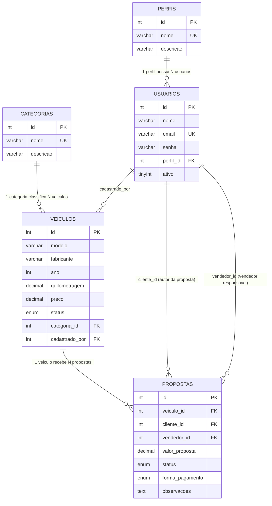

# 🚗 AutoPrime Motors - Sistema de Gestão de Concessionária

> **Projeto Integrador de Desenvolvimento Web & Banco de Dados**  
> **Entrega:** CRUD Completo Integrado entre Front-end, API REST e MySQL Workbench  
> **Repositório Oficial:** [github.com/Otaviiiiozzz/repositorio-concessionaria](https://github.com/Otaviiiiozzz/repositorio-concessionaria)

---

## 📌 1. Apresentação do Problema & Proposta de Solução

O **AutoPrime Motors** é uma aplicação web full-stack desenvolvida para a gestão moderna de uma concessionária de automóveis:
- **Catálogo & Estoque (Entidade Principal):** CRUD completo integrado de ponta a ponta (`POST`, `GET`, `PUT`, `DELETE`), persistido diretamente no **MySQL Workbench**.
- **Interface Web Reativa:** Front-end responsivo construído em **HTML5**, **CSS3** (tema Dark Premium automotivo) e **JavaScript vanilla**, manipulando dinamicamente o DOM e consumindo a API através da API **`Fetch`**.
- **Autenticação & Controle de Acesso (RBAC):** Proteção de rotas com **JSON Web Tokens (JWT)** e senhas criptografadas com **bcrypt**. As permissões são validadas de forma estrita no back-end via middlewares da API (não apenas escondendo botões na tela).
- **Relacionamentos e Regras de Negócio:** Suporte a categorias de veículos (`Sedan`, `SUV`, `Hatch`, `Picape`, `Esportivo`) e fluxo de propostas comerciais enviadas por clientes e geridas por vendedores.

---

## 🎯 2. Atendimento aos 4 Indicadores da Entrega

### Indicador 1: Implementa um CRUD completo integrado ao banco de dados
- **Cadastro (`POST /veiculos`):** Insere novos registros na tabela `veiculos` do MySQL Workbench, associando categoria e usuário cadastrador.
- **Consulta (`GET /veiculos` e `GET /veiculos/:id`):** Executa `SELECT` no MySQL com `JOIN` na tabela `categorias`, suportando busca por termo, filtro por fabricante, filtro por categoria e ordenação dinâmica.
- **Atualização (`PUT /veiculos/:id`):** Modifica dados cadastrais (modelo, fabricante, ano, quilometragem, preço, categoria) via comando `UPDATE` no MySQL.
- **Exclusão (`DELETE /veiculos/:id`):** Remove o veículo do banco de dados MySQL via comando `DELETE`.

### Indicador 2: Integra o front-end à API utilizando JavaScript, DOM e Fetch
- Interface interativa sem dependências de frameworks pesados:
  - Renderização dinâmica de linhas da tabela e cards informativos com `innerHTML` e manipulação de nós do DOM.
  - Formulário inteligente que alterna entre os modos **Cadastro** e **Edição**, preenchendo automaticamente os campos ao clicar em `✏️ Editar`.
  - Cards de métricas consolidadas (**Total de Veículos**, **Quilometragem Média** e **Valor Total do Estoque**) atualizados dinamicamente via Fetch da rota `GET /veiculos/resumo`.
  - Sistema de busca em tempo real com **debounce**, filtros combinados de categoria/fabricante e ordenação instantânea.
  - Modais interativos para autenticação (Login/Cadastro) e envio de propostas comerciais de compra.
  - Todas as chamadas ao servidor utilizam `fetch()` com `async/await`, envio de headers `Authorization: Bearer <token>` e tratamento de respostas/erros.

### Indicador 3: Aplica corretamente permissões e regras de negócio
> ⚠️ **Atenção atendida à risca:** As permissões não são meramente visuais; **todas são validadas obrigatoriamente pela API** por meio dos middlewares `autenticarToken` e `autorizarPerfis`.

| Nível / Perfil | Visualização do Catálogo | Cadastrar / Editar Veículo | Excluir Veículo do Estoque | Enviar Proposta Comercial |
| :--- | :---: | :---: | :---: | :---: |
| **Visitante (Sem Login)** | ✅ Permitido | ❌ Bloqueado (`401 Unauthorized`) | ❌ Bloqueado (`401 Unauthorized`) | ❌ Requer Login |
| **Cliente (`cliente`)** | ✅ Permitido | ❌ Bloqueado pela API (`403 Forbidden`) | ❌ Bloqueado pela API (`403 Forbidden`) | ✅ Permitido (`201 Created`) |
| **Vendedor (`vendedor`)** | ✅ Permitido | ✅ Permitido (`201 / 200`) | ❌ Bloqueado pela API (`403 Forbidden`) | ✅ Aprova / Recusa |
| **Admin (`admin`)** | ✅ Permitido | ✅ Permitido (`201 / 200`) | ✅ **Exclusividade do Admin** (`200 OK`) | ✅ Gestão Total |

**Regras de Negócio Validadas no Back-end:**
- Ano do veículo deve ser um número inteiro coerente (entre 1900 e o ano seguinte ao atual).
- Quilometragem deve ser um valor numérico não-negativo.
- Preço de venda deve ser maior que zero.
- Campos obrigatórios (modelo e fabricante) não podem ser vazios.
- Unicidade de e-mails no cadastro (`409 Conflict`) e senha com requisitos mínimos de segurança (mínimo de 6 caracteres).

### Indicador 4: Demonstra evolução contínua e organização no GitHub
- Repositório mantido com commits semânticos e organizados.
- Arquitetura limpa em camadas (MVC).
- Scripts automatizados para execução, testes e restauração do banco.
- Proteção de credenciais (`.env` e `node_modules` estritamente no `.gitignore`).

---

## 🗄️ 3. Integração com MySQL Workbench

O banco de dados relacional é o **único repositório central de dados** da aplicação. As tabelas foram criadas com integridade referencial:



### Script SQL Disponível
O script DDL/DML completo com a estrutura de tabelas e dados iniciais está disponível em:
👉 **[`sql/concessionaria.sql`](file:///sql/concessionaria.sql)**

### Consultas Rápidas no MySQL Workbench
```sql
USE concessionaria;

-- Visualizar o estoque completo de veículos com categoria
SELECT v.id, v.modelo, v.fabricante, c.nome AS categoria, v.ano, v.quilometragem, v.preco, v.status
FROM veiculos v
LEFT JOIN categorias c ON v.categoria_id = c.id
ORDER BY v.id DESC;

-- Visualizar usuários e seus perfis de acesso
SELECT u.id, u.nome, u.email, p.nome AS perfil, u.ativo
FROM usuarios u
INNER JOIN perfis p ON u.perfil_id = p.id;

-- Visualizar propostas comerciais vinculadas
SELECT p.id, v.modelo AS veiculo, u.nome AS cliente, p.valor_proposta, p.status, p.forma_pagamento
FROM propostas p
INNER JOIN veiculos v ON p.veiculo_id = v.id
INNER JOIN usuarios u ON p.cliente_id = u.id;
```

---

## 👥 4. Credenciais de Teste para Apresentação

O sistema possui 3 contas pré-cadastradas no MySQL Workbench com senhas criptografadas em bcrypt:

| Perfil | E-mail | Senha | Finalidade na Apresentação |
| :--- | :--- | :--- | :--- |
| 🔴 **Administrador** | `admin@autoprime.com` | `admin123` | Demonstrar permissão total: criação, edição e **exclusão de veículos**. |
| 🟡 **Vendedor** | `vendedor@autoprime.com` | `vendedor123` | Demonstrar permissão de criar e editar veículos, e aprovar propostas de compra. **Bloqueado de excluir** (API retorna 403). |
| 🔵 **Cliente** | `cliente@autoprime.com` | `cliente123` | Demonstrar envio de propostas de compra. **Bloqueado de criar/editar/excluir veículos** (API retorna 403). |

> 💡 **Atalho no Front-end:** O modal de Login conta com botões de **Acesso Rápido** (⚡ Admin, ⚡ Vendedor, ⚡ Cliente) que preenchem e autenticam com 1 clique para agilizar a demonstração em sala de aula!

---

## 🚀 5. Como Executar no VSCode

### Passo 1: Abrir no VSCode
Abra a pasta do projeto no VSCode.

### Passo 2: Iniciar o MySQL
Se o serviço MySQL ainda não estiver rodando no seu computador:
- Dê duplo-clique em **`iniciar-mysql.bat`** (ou inicie pelo MySQL Workbench / XAMPP).

### Passo 3: Iniciar o Backend
Você pode iniciar de 3 formas simples:
- **Opção A (Mais fácil):** Pressione a tecla **`F5`** no VSCode (Executar e Depurar pré-configurado).
- **Opção B (Dois cliques):** Dê duplo-clique em **`iniciar-servidor.bat`**.
- **Opção C (Terminal):**
  ```bash
  cd backend
  npm start
  ```

### Passo 4: Abrir a Interface Web
Abra o arquivo **`frontend/index.html`** no seu navegador de preferência (ou use a extensão *Live Server* do VSCode).

---

## 🧪 6. Testes Automatizados E2E (29 Casos Aprovados)

O projeto conta com suíte de testes de ponta a ponta validando o CRUD, integração com MySQL, autenticação JWT e restrições de perfil:

Para executar:
```bash
node tests/test-api.js
# ou dê duplo-clique em testar-api.bat
```

**Resultado:**
```text
=======================================================
🚗 AutoPrime - Suíte de Testes da API (Banco & Auth)
🎯 Alvo: http://localhost:3000
=======================================================
  ✔ [PASSOU] GET / responde com status 200
  ✔ [PASSOU] GET /veiculos é público (200)
  ✔ [PASSOU] GET /veiculos retorna lista de automóveis
  ✔ [PASSOU] GET /veiculos/resumo retorna métricas consolidadas
  ✔ [PASSOU] POST /auth/registrar cadastra usuário com sucesso (201)
  ✔ [PASSOU] POST /auth/registrar rejeita e-mail duplicado com status 409
  ✔ [PASSOU] Login de Administrador aprovado com sucesso (200)
  ✔ [PASSOU] Login de Vendedor aprovado com perfil 'vendedor' (200)
  ✔ [PASSOU] Login de Cliente aprovado com perfil 'cliente' (200)
  ✔ [PASSOU] Cliente é BLOQUEADO ao tentar cadastrar veículo (403 Forbidden)
  ✔ [PASSOU] Vendedor CADASTRA veículo com sucesso (201 Created)
  ✔ [PASSOU] Vendedor EDITA dados do veículo com sucesso (200 OK)
  ✔ [PASSOU] Vendedor é BLOQUEADO ao tentar excluir veículo (403 Forbidden)
  ✔ [PASSOU] Administrador EXCLUI veículo com sucesso (200 OK)
  ✔ [PASSOU] Veículo excluído não existe mais no estoque (404 Not Found)
  ✔ [PASSOU] Negociação & Propostas relacionando Veículos e Usuários
=======================================================
📊 Relatório: 29 de 29 Casos Aprovados (100% Sucesso)
🎉 TODOS OS TESTES PASSARAM COM SUCESSO NO MYSQL!
=======================================================
```

---

## ⚡ 7. Utilização com Thunder Client

A coleção com todas as requisições configuradas (`POST`, `GET`, `PUT`, `DELETE`, `/auth`, `/propostas`) e as variáveis de ambiente com os tokens JWT já estão prontas nas pastas:
- `thunder-client/` (para importação manual se desejar)
- `thunder-tests/` (sincronização nativa direta no VSCode)

---

## 👨‍💻 Autor & Instituição
- **Estudante:** Otávio Martins
- **Instituição:** Senac RS
- **Licença:** MIT
